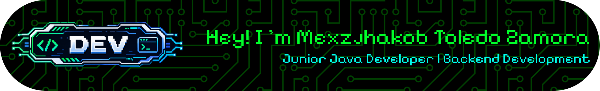

## 👋 About me

Hi! Thanks for taking the time to stop by. I enjoy understanding how systems work under the hood and turning a messy problem into working software.

🤝 **How I work**

For me, software development is about more than writing code. It's about understanding requirements, analyzing problems, and finding solutions that meet real needs. I've collaborated with different teams, communicated with clients to clarify requirements, presented demos of our work, and documented implementations so other team members can understand and maintain them. I enjoy exchanging ideas, proposing solutions, and adapting to different ways of working.

🚀 **What I'm looking for**

I'm looking for opportunities to contribute to meaningful software projects, collaborate with other developers, and continue growing as a software engineer. I enjoy learning new technologies, exploring unfamiliar challenges, and turning ideas into practical solutions. I'm always willing to take on new challenges and improve the way I approach problems.

Thank you for visiting my profile — I appreciate it, and I hope you have a great day.

## 💼 Experience

💻 **My experience**

Throughout my professional experience, I've contributed to developing software solutions, building backend functionality, integrating systems, and creating user interfaces. I've also worked on application security and deployment configurations, gaining experience in different aspects of the software development process.

## 🛠 Tech stack

🧩 **Languages**

⚙️ **Backend & APIs**

🗄️ **Data**

🎨 **Frontend (working knowledge)**

🧪 **Testing (in progress)**

🚀 **DevOps & platforms**

🧰 **Tools & workflow**

![Slack](https://img.shields.io/badge/Slack-4A154B?style=for-the-badge&logo=data:image/svg%2bxml;base64,PHN2ZyB4bWxucz0iaHR0cDovL3d3dy53My5vcmcvMjAwMC9zdmciIHZpZXdCb3g9IjAgMCAyNCAyNCI%2BPHBhdGggZmlsbD0iI2ZmZiIgZD0iTTUuMDQyIDE1LjE2NWEyLjUyOCAyLjUyOCAwIDAgMS0yLjUyIDIuNTIzQTIuNTI4IDIuNTI4IDAgMCAxIDAgMTUuMTY1YTIuNTI3IDIuNTI3IDAgMCAxIDIuNTIyLTIuNTJoMi41MnYyLjUyek02LjMxMyAxNS4xNjVhMi41MjcgMi41MjcgMCAwIDEgMi41MjEtMi41MiAyLjUyNyAyLjUyNyAwIDAgMSAyLjUyMSAyLjUydjYuMzEzQTIuNTI4IDIuNTI4IDAgMCAxIDguODM0IDI0YTIuNTI4IDIuNTI4IDAgMCAxLTIuNTIxLTIuNTIydi02LjMxM3pNOC44MzQgNS4wNDJhMi41MjggMi41MjggMCAwIDEtMi41MjEtMi41MkEyLjUyOCAyLjUyOCAwIDAgMSA4LjgzNCAwYTIuNTI4IDIuNTI4IDAgMCAxIDIuNTIxIDIuNTIydjIuNTJIOC44MzR6TTguODM0IDYuMzEzYTIuNTI4IDIuNTI4IDAgMCAxIDIuNTIxIDIuNTIxIDIuNTI4IDIuNTI4IDAgMCAxLTIuNTIxIDIuNTIxSDIuNTIyQTIuNTI4IDIuNTI4IDAgMCAxIDAgOC44MzRhMi41MjggMi41MjggMCAwIDEgMi41MjItMi41MjFoNi4zMTJ6TTE4Ljk1NiA4LjgzNGEyLjUyOCAyLjUyOCAwIDAgMSAyLjUyMi0yLjUyMUEyLjUyOCAyLjUyOCAwIDAgMSAyNCA4LjgzNGEyLjUyOCAyLjUyOCAwIDAgMS0yLjUyMiAyLjUyMWgtMi41MjJWOC44MzR6TTE3LjY4OCA4LjgzNGEyLjUyOCAyLjUyOCAwIDAgMS0yLjUyMyAyLjUyMSAyLjUyNyAyLjUyNyAwIDAgMS0yLjUyLTIuNTIxVjIuNTIyQTIuNTI3IDIuNTI3IDAgMCAxIDE1LjE2NSAwYTIuNTI4IDIuNTI4IDAgMCAxIDIuNTIzIDIuNTIydjYuMzEyek0xNS4xNjUgMTguOTU2YTIuNTI4IDIuNTI4IDAgMCAxIDIuNTIzIDIuNTIyQTIuNTI4IDIuNTI4IDAgMCAxIDE1LjE2NSAyNGEyLjUyNyAyLjUyNyAwIDAgMS0yLjUyLTIuNTIydi0yLjUyMmgyLjUyek0xNS4xNjUgMTcuNjg4YTIuNTI3IDIuNTI3IDAgMCAxLTIuNTItMi41MjMgMi41MjYgMi41MjYgMCAwIDEgMi41Mi0yLjUyaDYuMzEzQTIuNTI3IDIuNTI3IDAgMCAxIDI0IDE1LjE2NWEyLjUyOCAyLjUyOCAwIDAgMS0yLjUyMiAyLjUyM2gtNi4zMTN6Ii8%2BPC9zdmc%2B)

## 🚧 Currently building

## 📚 Currently learning

- Automated testing with **JUnit and Mockito** — bringing tests into my Java workflow.
- **OpenCode** and AI-assisted development workflows.

## 📫 Contact

For work inquiries or a direct conversation, reach me on LinkedIn or by email.

<!-- Portfolio link goes here when the site is live -->

## 📈 Developer profiles

Platforms where you can see my practice, problem-solving and learning progress.

## 📊 GitHub stats

<table>
  <tr>
    <td align="left">
      
    </td>
    <td align="right">
      
    </td>
  </tr>
  <tr>
    <td align="center" colspan="2">
      
    </td>
  </tr>
</table>
